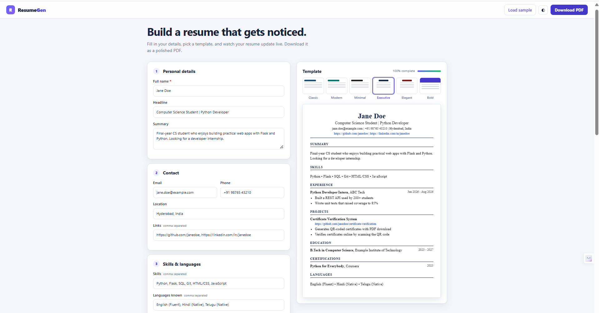

# ResumeGen

A web app that turns a simple form into a clean, professional **PDF resume**.
Fill in your details, pick one of six templates, watch the live preview update, and download.



## Features

- Live preview that updates as you type
- **Six templates**: Classic, Modern, Minimal, Executive, Elegant and Bold, each with its own layout and typography
- Sections for personal details, contact info, skills, languages, experience, projects, education and certificates
- Add or remove as many entries as you need in each repeatable section
- Clickable links inside the generated PDF
- "Load sample" button to preview a filled-in resume instantly
- Resume completeness meter
- Light and dark interface, fully responsive
- Input validation and safe handling of special characters
- Automated tests that build a PDF with every template

## Tech stack

| Part | Technology |
| --- | --- |
| Backend | Python, Flask |
| PDF generation | ReportLab |
| Frontend | HTML, CSS, vanilla JavaScript |

## Getting started

```bash
# 1. Clone the repository
git clone https://github.com/<your-username>/resume-generator.git
cd resume-generator

# 2. Create and activate a virtual environment
python -m venv venv
venv\Scripts\activate          # Windows
# source venv/bin/activate     # macOS / Linux

# 3. Install dependencies
pip install -r requirements.txt

# 4. Run the app
python app.py
```

Open http://127.0.0.1:5000 in your browser.

## Running the tests

```bash
python -m unittest discover tests
```

## Project structure

```
resume-generator/
├── app.py              # Flask routes and form handling
├── pdf_generator.py    # Templates and PDF layout (ReportLab)
├── templates/          # HTML page
├── static/             # CSS and JavaScript
├── tests/              # Automated tests
└── requirements.txt
```

## How it works

1. The browser sends the form data to the `/download` route.
2. `app.py` cleans and validates the data.
3. `pdf_generator.py` lays out the resume using the chosen template and returns a PDF.
4. Flask sends the PDF back as a download.

## Adding your own template

Templates live in the `THEMES` dictionary in `pdf_generator.py`. Add an entry with a
colour, a font, a header style and a heading style:

```python
"ocean": {"label": "Ocean", "accent": "#0369a1", "font": "Helvetica",
          "header": "left", "heading": "bar"},
```

Then add a matching `.preview[data-theme="ocean"]` colour in `static/style.css`
so the live preview matches.

## Roadmap

- [ ] Save and reload resumes (SQLite)
- [ ] Export to DOCX
- [ ] AI-powered bullet point suggestions
- [ ] Profile photo support

## License

Released under the [MIT License](LICENSE).
